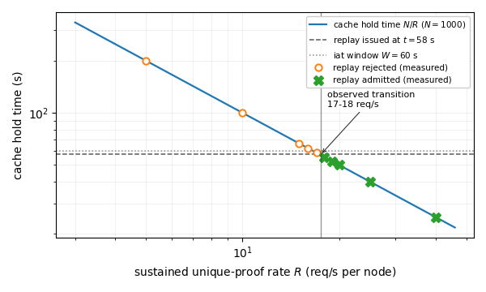

# DPoP Replay-Cache Threshold: Artifact

[](https://doi.org/10.5281/zenodo.23687979)

Code and results for *Operational Realities of Sender-Constrained OAuth: Replay-State
Scaling Thresholds and Silent Binding Failures in Distributed Resource-Server Deployments*.
Published in *Kölner Beiträge zur technischen Informatik*, Band 3/2026, TH Köln,
[doi:10.57684/COS-1495](https://doi.org/10.57684/COS-1495). The artifact is archived on Zenodo,
[doi:10.5281/zenodo.23687979](https://doi.org/10.5281/zenodo.23687979) (all versions).

> **Status, October 2026.** Spring Security 7.0.7 and 7.1.1, released 2026-08-20, replace
> the cache studied here with `DPoPProofReplayValidator`: 100,000 entries, at most 1000 per
> client key, a ±30 s window, and a full cache rejects new proofs instead of evicting old
> ones. The results below apply to Spring Security 6.5.x (6.5.11, the last open-source
> 6.5 release, still ships the old cache), 7.0.0 to 7.0.6, and 7.1.0. On those versions,
> upgrade to 7.0.7, 7.1.1 or later.

## Overview

OAuth 2.0 can sender-constrain an access token by binding it to a key held by the client,
so a stolen token is not usable on its own. DPoP (RFC 9449) does this at the application
layer: the client signs a short-lived proof for each request, and the resource server
rejects any proof it has already seen. Detecting a repeat requires the server to retain
recent proof identifiers, which it does in a replay cache.

This work shows that the default DPoP replay cache in Spring Security 6.5, and in 7.x before
7.0.7 and 7.1.1, cannot sustain that guarantee under realistic load. The cache holds 1000 entries and evicts the
oldest first, so once roughly 1000 fresh proofs pass through it a previously seen proof is
evicted and becomes replayable. On a single node this occurs above approximately 17
requests per second, with no error and no log entry. The cache is a single instance shared
by every client on the node and is written before the token-binding checks run, so a
holder of a stolen token, or an unrelated high-traffic client, can force a target's proof
out of it.

The repository contains the analysis, a runnable stack that demonstrates each result, and
the committed outputs of executing it. It separates three categories of claim and does not
mix them: results derived by reading the published Spring Security source, demonstrations
that were executed with their outputs committed, and a protocol for measurements that were
not executed and are marked as such.

## Contents

1. [Analytical result](#1-analytical-result)
2. [Reproduced results](#2-reproduced-results)
3. [Not evaluated](#3-not-evaluated)
4. [Pre-registration](#4-pre-registration)
5. [Reproducing the results](#5-reproducing-the-results)
6. [Repository structure](#6-repository-structure)
7. [Intentionally insecure configurations](#7-intentionally-insecure-configurations)
8. [Software environment](#8-software-environment)
9. [License](#9-license)

## 1. Analytical result

Spring Security's default DPoP replay cache holds `N = 1000` entries and evicts the oldest
first. A DPoP proof is accepted while its `iat` is within a clock-skew tolerance `S = 60 s`
of now. At a sustained unique-proof rate `R`, an entry is displaced after about `N/R`
seconds, so a replay of an honestly issued proof is admitted once eviction beats the
window:

```
N / R < S    <=>    R > R* = N / S  ≈  17 req/s per node
```

The `iat` check is two-sided (`iat ± S`), so a client that dates its proof into the future
gets the full `2S = 120 s`. A cache that must hold against any `iat` a client may choose is
safe only below `N / 2S ≈ 8 req/s`. Both constants come from the 6.5.5 source
(`JtiCache.MAX_SIZE`, `JwtIssuedAtValidator.clockSkew`), not from assumption.

`R*` describes honest traffic. The eviction budget is also attacker-controlled: because the
validator inserts the `jti` before it checks the token binding, and the cache is one
JVM-wide instance shared across all clients, a stolen-token holder or even a busy neighbour
can evict a target `jti` and make a captured proof replayable. Section 2 lists the runs
that show this.



## 2. Reproduced results

Every figure below is from a committed run under the named `results/` file.

| Condition | Shows | Result |
|---|---|---|
| D1 threshold | the `R*` crossover | 20 runs, rejected 5–17 req/s, admitted 18–40 |
| D1 correctness | defence holds at idle | 18 passed, 2 skipped |
| Attacker flood | attacker forces eviction | 1000 self-signed proofs (all 401) evict the victim proof in ~1 s at idle |
| Cross-tenant | eviction with no rejected request | a neighbour's 1000 HTTP 200s evict a low-traffic `jti` |
| Delay sweep | outcome tracks `R·t`, not rate alone | crossover moves as `N/R`: ~50 s at 20 req/s, ~25 s at 40 |
| `iat` window | window is two-sided | accepted across `iat ± ~60 s` |
| D2 default cache | multi-node replay | one proof accepted by all three replicas at 1 req/s |
| D2 Redis cache | shared state fixes it | one acceptance, rest rejected; fails closed when Redis is down |
| C0 / M1 | bearer baseline, mTLS binding | 24 passed |
| X1 / X2 | cert metadata across TLS termination | 25 passed |
| D4 | single-use nonce enforcement | refuse, issue, accept, rotate, reject replay |

At 17 req/s the sweep records 986 insertions, below the 1000 bound, and the replay is
rejected; at 18 req/s it records 1044 and the replay succeeds.

## 3. Not evaluated

The DPoP-versus-mTLS latency comparison and hypotheses H1–H4 in `PREREGISTRATION.md`. They
need a measurement environment this artifact does not provide, and no outcome for them is
claimed anywhere. `measurement-matrix/analysis/` holds the statistical pipeline, validated
on synthetic data only.

Building that pipeline early surfaced a flaw in the pre-registered plan: the split-half
Kolmogorov–Smirnov stationarity test rejects 88.5% of series that are stationary by
construction, because it assumes independent samples and latency series are autocorrelated.
`docs/DEVIATIONS.md` records this rather than quietly changing the plan.

## 4. Pre-registration

`PREREGISTRATION.md` holds only the hypotheses and protocol: no stack, no measurement code,
no results. H1–H4 have not been run, so no data for them exists.

The git commit timestamps do not establish the order in which the files were written, so
the statement in the paper's Appendix A that the ordering is verifiable from the repository
history does not hold. See [`docs/DEVIATIONS.md`](docs/DEVIATIONS.md#commit-timestamps).

## 5. Reproducing the results

Needs Docker with Compose and `python3` with `httpx` and `cryptography`.

```
./reproduce.sh                         # full D1 sweep, ~30 min
RATES=16,18 REPEATS=1 ./reproduce.sh   # smoke test, ~3 min, still straddles the threshold
python3 single-host-validation/check_results.py   # verify a run against the model
```

`check_results.py` exits 0 when the run reproduces, 2 when the host was too slow to sustain
the rate, and 1 on a genuine model mismatch. Each condition under `measurement-matrix/` has
its own stack, README, and loopback-bound ports; run them one at a time.

## 6. Repository structure

```
PREREGISTRATION.md          hypotheses and protocol; H1-H4 not yet run
PROTOCOL.md                 measurement protocol
docs/ARTIFACT-APPENDIX.md   claim-to-experiment map (USENIX template)
docs/DEVIATIONS.md          departures from the plan, and a known flaw in it
single-host-validation/     D1, plus adversarial/ (attacker, cross-tenant, sweeps)
measurement-matrix/         D2, C0/M1, X1/X2, D4, and the analysis pipeline
reproduce.sh                one-command D1 run
```

## 7. Intentionally insecure configurations

This artifact studies insecure behaviour, so parts of it are insecure on purpose. None of
it is deployment guidance.

- `single-host-validation/` runs the stock Spring Security default cache. That default is
  the subject of the study.
- `measurement-matrix/xfcc-silent-binding/` includes a validator that fails open on
  purpose, to demonstrate a silent failure. Do not copy it.
- All stacks use throwaway credentials and locally generated PKI, bound to localhost. Keys
  are generated at run time and never committed.

## 8. Software environment

All components are version-pinned so that the source-level claims are reproducible against
the exact releases examined:

| Component | Version |
|---|---|
| Keycloak | 26.6.1 |
| Spring Boot | 3.5.5 |
| Spring Security | 6.5.5 |
| Redis | 7 |
| Envoy | 1.35 |
| Java | 21 |

Every claim about library behaviour was read from the corresponding source tag. Full
citations for the standards, disclosed defects, and prior work referenced here are in
[`REFERENCES.md`](REFERENCES.md).

## 9. License

Released under the Apache License 2.0. See [`LICENSE`](LICENSE). If you use this artifact,
please cite it using the metadata in [`CITATION.cff`](CITATION.cff).
